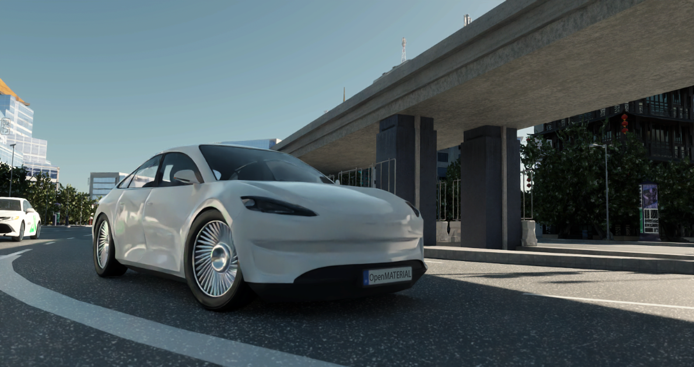

# aiSim Archer

aiSim Archer is a fictitious vehicle designed to combine modern car aesthetics with real-time rendering optimization, making it an ideal example of standards-driven 3D simulation.

## Key features

- **High-resolution design:** Comprising approximately 140,000 triangles, aiSim Archer features intricate exterior details and a simplified schematic interior for streamlined performance.
- **Standards-compliant structure:** Faithfully adheres to the ASAM OpenMATERIAL 3D conventions for hierarchy, transformations, pivot placement, and naming.
- **Flexible customization:** A fully UV-unwrapped layout enables seamless texturing and parameter-driven materials, complemented by additional tire normal maps for high-quality visuals.
- **Ready for integration:** A complete package including a glTF 3D model, texture files, and an `.xoma` descriptor for easy integration.
- **ASAM OpenMATERIAL 3D 1.1 support:** The model uses features introduced in OpenMATERIAL 3D 1.1, including 23 optimized light sources and geometric thickness on glass surfaces.